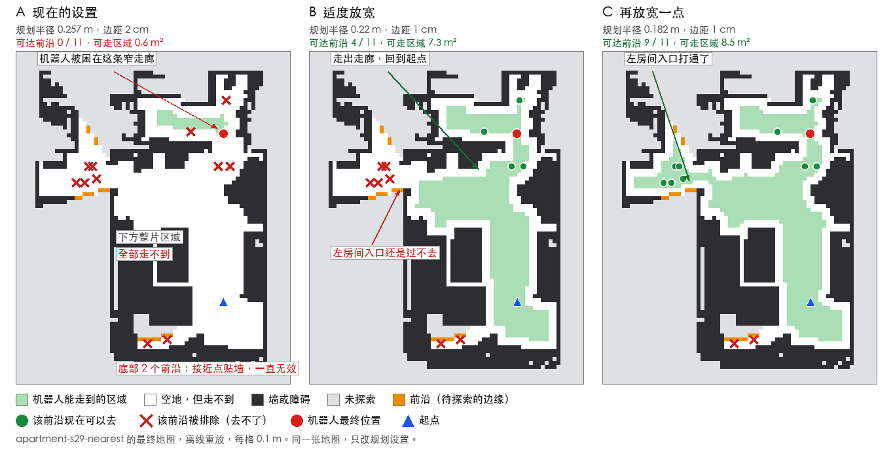

# Frontier 失败分析：保守的规划、B 的改动，以及队友需要做的事

范围：`integration/w2` 上 36 回合配对实验（`report/`）的失败原因；B（导航与规划）新增的可选配置；各角色的后续工作。
**状态：PyBullet 离线验证通过，尚未在原生 iGibson 中验证。** 全部新行为默认关闭，不传参数时与此前完全一致。

## 结论

36 个回合中 15 个失败，其中 13 个是导航层把所有前沿都判成"去不了"，机器人没有下一步可走。这些"去不了"里，大部分是**规划太保守**造成的，不是地图上真的没有路。

最大的一处保守来自足迹：规划把 Locobot 当成一个**外接圆半径 0.257 m 的方块**，而真实机器人基座是**半径约 0.19 m 的圆**。B 新增的 `footprint_override` 选项在 B 内部换成圆形足迹，不改共享的 manifest。在 PyBullet 加真实 Locobot URDF 和 Rs 网格里，15 个失败回合从最终状态继续走，120 次试验全部干净到达。

## 1. 本次之前的问题：保守的规划

36 个回合成功 21 个。15 个失败里：13 个终止于 `no_feasible_frontiers`（所有前沿都被排除），2 个终止于 `search_limit`。所有回合接触步数为 0，误声明为 0。

导航层对每个前沿的接近点做检查，通不过就贴 `no_path`（走不过去）或 `invalid_goal`（接近点放不下机器人）。合格名单为空，回合就结束。在最终地图上逐个重放，保守来自四层叠加：

1. **足迹是方的。** 配置里用 ±0.181 m 的方形，规划取它的外接圆，半径 0.257 m。真实基座是圆柱（碰撞半径 0.178 m，网格最大约 0.188 m），规划把机器人算大了约三分之一。
2. **2 cm 安全边距。** 它是开发用 manifest 里的取值（`locobot_multiframe.md` 第 46 行），文档没有给理由。在两个回合里，仅这 2 cm 就让机器人所在的位置被判无效，可走格子为 0。
3. **转向保护也按方形检查。** 方形转动时对角会扫到 0.257 m，所以窄处的原地转向被拦下（`blocked`，零接触）。圆形机器人没有这个问题。
4. **失败策略会造成死锁。** `interface_freeze.md` 5.2 规定 `NO_PATH`、`INVALID_GOAL` 在证据变化前一直被压制。被困的机器人产生不了新证据，前沿永远被压制。

15 个失败回合的分类（离线重放最终地图与日志）：

| 类别 | 回合数 | 说明 |
|---|---|---|
| 规划保守把机器人困住 | 10 | 现行设置下机器人周围只有 0–14 个可走格子，放宽后重新有可达前沿 |
| 剩下的可达前沿只是碎片 | 3 | 被 `no_progress` 规则拉黑；实质前沿仍被规划挡住 |
| 扫描卡住后被操作上限截断 | 2 | clutter-s43 的 IG 和 LLM：在左房间入口的一次扫描 5 个朝向只完成 3 个，之后约 187 仿真秒没有进展。单次操作上限 400 同时按仿真时间和墙钟时间各算一次（`runner/episode.py` 第 247 行），仿真比实时慢，墙钟先到 |



*apartment-s29-nearest 的最终地图，同一张图只改规划设置。A 现行设置：机器人（红点）被困在上方窄走廊，可走区域 0.6 m²，11 个前沿全部被排除。B 规划半径 0.22、边距 1 cm：能回到起点。C 半径 0.182、边距 1 cm：左房间入口也通了。*

## 2. 验证

macOS 上无法运行项目的 iGibson 渲染器（优化渲染器在 macOS 上直接退出），所以用 PyBullet 的无渲染模式，加载**真实的 Locobot URDF 和 Rs 扫描网格**，让 B 的真实导航器驱动机器人。

**36 个回合的 198 次导航派发重放**（用日志里记录的地图、起点和目标）：

| 设置 | 干净到达 / 198 | 说明 |
|---|---|---|
| 现行设置 | 197–198 | 原来到达的 193 次里 192–193 次重放也到达，物理重放基本可信；原来没到达的 5 次重放里都到达了，所以复现不了原来的失败 |
| 规划参数 + 近障限速 | 176–182 | 16–22 次在毫米级地面台阶处停滞，零接触，不如现行设置 |
| 只改规划参数（不限速） | 198 | 两种地面高度、两档噪声都是 198/198，零接触，零停滞 |
| **圆形足迹覆盖（推荐配置）** | **198（396/396，两档噪声）** | manifest 保持方形，零接触，零停滞，两种地面高度结果相同 |

**15 个失败回合，从最终地图和位姿走向新设置下最近的可去前沿**（每个回合 8 次）：

| 设置 | 干净到达 | 被拦下（零接触） | 被拒绝 |
|---|---|---|---|
| 现行设置 | 32 | 0 | 88 |
| 规划参数（仍是方形足迹） | 50 | 62 | 8 |
| 圆形足迹覆盖（推荐配置） | **120** | **0** | **0** |

要点：
- 方形足迹下 7 个回合的机器人连 0.85–0.9 m 都走不出去，是转向保护按方形检查拦下的，换成圆形全部通过。
- 此前在几何 mock 和方形机器人物理里测到的"边转边走蹭墙角"碰撞，是把机器人当成方块造成的，对真实的圆形基座偏高，不要引用。
- 近障限速在真实机器人上不需要，反而会让机器人在地面台阶处停滞，所以不在推荐配置里。

## 3. 碰撞怎么算

团队的要求：像扫地机器人一样，轻触可以，碰撞不行。

项目现有的接触定义（`simulation/igibson_adapter.py`）：非地面物体、接触点高于底盘 6 cm、法向力大于 0.1 N，数的是控制步，不是事件。这个阈值几乎等于任何触碰。

本分析采用的碰撞定义：**接触后被运行时保护拦下（`blocked`）算碰撞**，接触后还能到达目标的算轻触。建议报告里同时给出两个数：几何接触率，和接触后卡住的碰撞率，并写明定义。`blocked` 不等于接触，真实运行里大多数 `blocked` 是转向保护主动拦下，零接触。

适配器新增了峰值法向力 `peak_contact_force_n` 和最长连续接触步数 `longest_contact_run_steps`，以便区分轻触和撞击；原有 `collisions` 不变。

## 4. B 改了什么

全部在 B 的文件里；新行为默认关闭。没有改 A、C 和共享契约。

| 文件 | 改动 |
|---|---|
| `navigation/costmap.py` | 新增 `start_margin_m`（起点用物理判断，不加规划边距）、`margin_m` 覆盖、`start_pose_valid()`、`near_obstacle()` |
| `navigation/planner.py` | 起点可用性改用 `start_margin_m` |
| `navigation/navigator.py` | `TeamNavigator` 新增选项 `planning_margin_m`、`start_margin_m`、`near_obstacle_limit`（默认关闭，不建议启用）、`footprint_override`（B 内部替换足迹，不改共享的 manifest） |
| `navigation/locobot_robot.py` | 新增圆形足迹 `LOCOBOT_ROUND_ROBOT`（16 边形，半径 0.19 m）、`ROUND_FOOTPRINT_NAV_OPTIONS`（manifest 本身是圆形时用）、`ROUND_FOOTPRINT_OVERRIDE_NAV_OPTIONS`（**推荐**：圆形足迹覆盖，边距 0.01，起点边距 0，manifest 保持方形）、预设 `SOFT_CONTACT_NAV_OPTIONS`（规划半径 0.182，不含限速） |
| `simulation/igibson_adapter.py` | 新增峰值接触力和最长接触步数，原有 `collisions` 不变 |
| `tests/test_soft_contact.py` | 新增 32 个测试 |

推荐用法：

```python
from frontier_search.navigation.locobot_robot import ROUND_FOOTPRINT_OVERRIDE_NAV_OPTIONS
nav = TeamNavigator(sim, linear_gain=2., **ROUND_FOOTPRINT_OVERRIDE_NAV_OPTIONS)
```

manifest 里的机器人仍是方形，A 选前沿接近点和出生净空种子都和以前一样，只有 B 的检查（代价地图、转向、扫掠）变成圆形。

参数的机器人学依据：

- **足迹形状。** 配置空间方法（Lozano-Pérez 1983）要求用机器人真实形状膨胀障碍。方形取外接圆比真实的圆多出约三分之一；16 边形外接于测得的基座半径，包住基座。
- **边距 0.01。** 边距吸收地图（10 cm 一格）和定位误差。0.19 m 的圆加 0.01 m 边距刚好覆盖测得的 0.188 m 基座半径；**不要设成 0**。
- **起点边距 0。** 边距是规划缓冲，不是物理。没有碰到任何东西的机器人不应因位姿落在缓冲区内被判成动不了。

## 5. 队友需要做什么

| 谁 | 要做的事 |
|---|---|
| 全员 | 决定是否采用圆形足迹。建议先用 B 里的覆盖选项（A、C 不受影响，但 A 选前沿接近点时仍按方形）；iGibson 验证通过后，再考虑改 manifest 里的机器人配置（A 和 B 同时生效，上限更高，但会改变 A 的输出，需要整批重跑）。 |
| A（感知） | 如果改 manifest：`perception/frontiers.py` 第 95 行和 `perception/mapper.py` 第 320 行用"最大顶点半径加边距"选接近点，净空要求会从约 0.277 m 降到约 0.21 m；出生净空种子（`mapper.py` 第 370 行）会变小，要确认和适配器的 `verify_spawn_clearance` 一致。 |
| C（策略与 runner） | 不需要改代码就能用 B 的选项。建议：（一）把 `runner/episode.py` 第 247 行单次操作上限的仿真时间和墙钟时间拆成两个独立的数；（二）评估是否给失败策略的死锁加一级有界的兜底重试（第 1 节第 4 点）；（三）把 `scripts/benchmark_episode.py` 第 122 行的 `TeamNavigator(sim, linear_gain=2.)` 改成上面的写法。 |
| 有 iGibson 的机器（Windows + NVIDIA） | （一）用真实模型确认 0.19 m 圆形足迹包得住整个机器人，包括机械臂和相机支架；（二）用同一批种子重跑 36 个回合，与现有结果并排报告，不覆盖原结果；（三）记录峰值接触力，用团队定义的碰撞口径统计；（四）确认地面毫米级台阶在原生 iGibson 里是否也会让机器人停滞。 |
| B | 足迹覆盖选项已实现；基准脚本的传参由 C 或负责跑基准的人改。 |

## 6. 没有验证的部分

- **以上验证全部是 PyBullet 加真实 Locobot URDF 和 Rs 网格的结果，不是原生 iGibson。** 轮子扭矩、摩擦、噪声（1 cm 定位偏移、3% 打滑）是假设的；轮子扭矩从 0.5 到 5 N·m 不影响结果。
- 为避免底盘被地面网格的毫米级起伏卡住，在复制的 URDF 里把底盘碰撞圆柱抬高了 2.5 cm，并给脚轮单独加了一个平地平面（项目文档的做法）。项目自己的 iGibson 运行没有被卡住，原因未知。
- 重放只验证导航段，不是回合成功率。失败回合新走到的前沿大多是 0.8–0.9 m 外的小碎片，走到它们不等于找到杯子。**放宽后的成功率没有数据，不要写进报告。**
- 物理里只有 Rs 的静态网格，没有杂乱物体和移动推车，所以只有 apartment 的 12 个回合在物理上忠实；clutter 和 dynamic 的地图里有这些障碍，物理里没有。
- 圆形足迹半径 0.19 m 来自基座网格顶点（0.188 m），其余部件只核对了项目测得的 ±0.181 m 范围。
- 验证用的 PyBullet 脚本和资产不在仓库里（资产来自 iGibson 公开下载，脚本在 B 的本地）。需要复现请向 B 索取。

数据来源：`report/raw-logs-20261019.zip` 的 `results.json`、`events.jsonl`、`final-state.json`；iGibson 公开资产（Locobot URDF、Rs 网格）；`Documentation/english/interface_freeze.md`、`Documentation/english/locobot_multiframe.md`。
