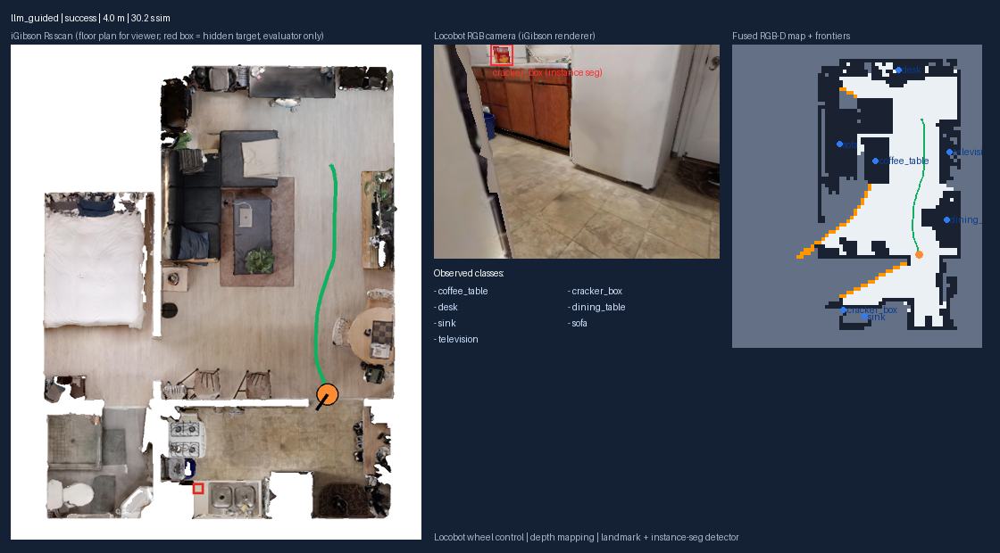

# iGibson Rs 场景：nearest 与 Gemini 目标搜索

在 iGibson 2.2.2 中重新完成 PyBullet 演示的闭环：官方 Gibson `Rs` 公寓扫描场景，iGibson 自带的 Locobot 差速机器人，iGibson 渲染器输出的 RGB、深度和实例分割。C 的策略、`WorldState`/`SelectionContext` 契约和 Gemini 客户端与 PyBullet 版本完全相同，只替换了仿真、建图和导航替身。原 synthetic case 与 PyBullet demo 保持不变。

## 结果（2026-09-30）

两次运行从相同初始状态出发。机器人位于客厅 (0.8, −2.4)，目标是 YCB `003_cracker_box`，放在厨房灶台旁的台面上，初始位置看不到。

| 条件 | 终止 | 决策数 | 实际移动 | 仿真时间 | 障碍接触步数 | 定位误差 | LLM 调用 / fallback |
|---|---|---:|---:|---:|---:|---:|---:|
| nearest | success | 5 | 12.131 m | 87.6 s | 0 | 0.030 m | – |
| Gemini 3.8 Flash | success | 1 | 4.041 m | 30.2 s | 0 | 0.032 m | 1 / 0 |

初始扫描后的候选：

| frontier | 区域 | B 评估路径代价 |
|---|---|---:|
| F1 | R1（客厅） | 不可达 |
| F2 | R1（客厅西侧，通向卧室） | 3.580 m |
| F3 | R1 | 3.931 m |
| F4 | R4（厨房方向，已探索 7.1%） | 4.107 m |

- **nearest**：依次选 F2 → 卧室 F7 → F6 → 卫生间 F10 → 厨房 F9。进入厨房途中两帧实例分割看到目标，当前导航被取消。
- **Gemini**：第一次决策直接选 F4，理由原文：“A cracker box is typically found in a kitchen or pantry. Region R1 is already over 82% explored and contains living room and dining furniture, whereas frontier F4 leads into unexplored region R4, which may contain a kitchen.” 到达厨房门口后，全景扫描确认目标。单次调用延迟约 6.9 s。

本次会话 4 次 live 运行中，Gemini 都选了 F4。这只是单一场景、单一起点的结果，不是统计结论；两种策略的差距主要来自该场景的布局和目标位置。

动画：[nearest](../igibson_demo/nearest.gif)、[Gemini](../igibson_demo/llm_guided.gif)。[results.json](../igibson_demo/results.json) 记录每次决策的候选、代价、理由、导航反馈和评分。



画面左侧是 Rs 数据集自带的平面图，仅供观看，红框为隐藏目标（只有评分器使用）；中间是 Locobot 相机画面，检测到目标时标出实例分割框；右侧是融合出的地图、frontier 和实际轨迹。

## 运行

```powershell
# 一次性：构建 iGibson、创建 Python 3.8 环境、下载 Rs 与 assets（约 600 MB）
python scripts/setup_igibson.py

.\scripts\run_igibson_demo.ps1 -Policy nearest
.\scripts\run_igibson_demo.ps1 -Policy llm_guided
.\scripts\run_igibson_demo.ps1 -Policy both
```

每次在 `runs/igibson-时间戳/` 写出 GIF、首末帧 PNG、完整 JSONL 和 summary。每个 episode 墙钟时间约 10 s，headless 渲染，不开窗口。`both` 会为每个策略各起一个进程，因为 iGibson 渲染器每个进程只持有一个 GL 上下文。导出文档包：`data/venv-igibson/Scripts/python.exe scripts/export_igibson_results.py runs/<目录>`。

Gemini 配置与 PyBullet demo 相同：先读仓库 `.env`，不存在时读上一级 `.env`。密钥不进入日志。

## 管线

1. **场景与机器人**：iGibson `Simulator`（headless，物理步长 1/120 s，控制步长 1/30 s）加载 `StaticIndoorScene('Rs', build_graph=False)`。场景自带的可通行图不加载，规划只用传感器建出的地图。Locobot 使用 `DifferentialDriveController`，只通过轮速指令移动，不 teleport。
2. **RGB-D 建图**：相机位于 Locobot `eyes` link，320×240，垂直 FOV 60°。行驶时云台俯仰 −25°；每个扫描朝向依次拍 −25° 和 0° 两帧，0° 用于看台面。iGibson 渲染的相机系点云变换到世界系后：高度 0.08 m 至机器人顶部 +0.05 m 的点记为障碍命中（≥3 次判定占据）；只有落在地面上的射线才沿途清除为空闲。栅格 0.1 m。起点半径 0.6 m 视为已知空闲（契约中的 `initial_clearance_cells`），机器人车身实际压过的格子也记为空闲。
3. **frontier 与 B 替身**：已知空闲且四邻接未知的格子按区域聚类，信息增益为簇周围 1 m 内的未知面积。路径用 8 邻接 Dijkstra，只走距障碍大于 0.23 m（半径 0.18 m + 0.05 m）且不贴未知区的格子；找不到可达接近点的 frontier 记为 `NO_PATH`。
4. **执行与反馈**：纯追踪控制，前视距离 0.35 m。行驶中每 0.5 s 拍一帧，更新地图、检查剩余路径，必要时重规划（最多 5 次）。以下情况判为 `blocked`：接触持续超过 20 步，或指令前进 3 s 位移小于 5 cm。到达后先转到接近朝向，再做 6 向全景扫描。已到达但未消失的 frontier 以 `no_progress` 排除。
5. **检测与评分**：目标由 iGibson 实例分割得到（≥40 像素），世界坐标取这些像素的深度点均值。首次看到后，再从下一个仿真时刻补拍一帧，两次独立采集后才提出 claim。评分器独立读取真实位置：只有 claim 证据均来自分割记录，且估计位置误差小于 0.5 m，才判 success。结果不回传策略。

## 简化与边界

- Gibson 静态扫描**没有物体和房间语义**。家具类别（sofa、bed、stove 等 11 类）是按 Rs 平面图手工标注的 3D 框，已逐一对照渲染视图核对。只有当渲染深度确认该框在 4 m 内可见时，才报告类别和标注中心。这是“标注地标 + 可见性 oracle”，不是 YOLO，位置也不是从像素估计的。
- 目标是真实 YCB 模型，以静态刚体插入：扫描出的台面不平，动态放置会滑进水槽。只有目标的类别来自真实渲染分割。
- 区域 R1–R4 是按平面图手画的房间框，作为允许的区域先验，沿用契约字段 `igibson_room_prior`；房间类型不提供给策略。
- 未使用 iGibson 交互场景 `Rs_int`：它需要申请 iGibson 数据集许可。当前只用公开可下载的 `Rs` 与 assets。
- Locobot 两处实测修正：
  - 该模型正角速度指令实际顺时针转，控制层取反，保持逆时针为正。
  - 球形脚轮会卡在扫描网格毫米级的门槛上，因此只让脚轮与 iGibson 平地面碰撞；轮子和车身仍与扫描网格完整碰撞。
- 无物理恢复策略；无候选时只代表当前地图没有可选 frontier，不能证明目标不存在。

## Windows 构建说明

`scripts/setup_igibson.py` 从官方源码构建 iGibson 2.2.2（commit `7d95982`）。本机为 VS 2026 / MSVC 14.51、CMake 4.4、RTX 4060。需要修两个上游问题：

1. 内置 Crypto++ 调用了新版 MSVC STL 已删除的 `stdext::make_(un)checked_array_iterator`，改走可移植分支。
2. `MeshRendererContext::loadTexture` 按 RGB 三通道解码，却按文件原始通道数（RGBA 为 4）缩放，会越界读内存；加载带 RGBA 贴图的机器人时直接崩溃。

另外，公开 assets 不含 PBR 环境贴图，PBR 物体会渲染成黑色，所以插入的 YCB 物体用非 PBR 着色。脚本还会处理：CMake 4 需要 `CMAKE_POLICY_VERSION_MINIMUM=3.5`；`setup.py` 期望的 OpenVR DLL 路径需要从 FetchContent 目录补上。依赖版本见 `requirements-igibson.txt`。

补丁函数已在当前源码上验证可重复执行，构建步骤也已在本机逐步执行过；完整脚本尚未在全新机器上从零跑过一遍。

## 检查

```powershell
$env:PYTHONPATH = "$PWD/src"
.\data\venv-igibson\Scripts\python.exe -m unittest discover -s tests -v   # 27 项全过，含 3 项 iGibson
.\.venv\Scripts\python.exe -m unittest discover -s tests                   # 24 项通过，iGibson 3 项跳过
```

iGibson 测试检查：

- 初始扫描后目标不在策略状态中，且地图同时有未知和占据；
- 候选路径只经过安全格，初始扫描无接触；
- 轮速指令符合逆时针为正的约定，直行方向与朝向一致；
- 从厨房观察时，两帧分割证据生成 claim，定位误差小于 0.2 m。

同时确认整个代码库可在 Python 3.8 下运行（此前 README 注明未在 3.8 实测）。
