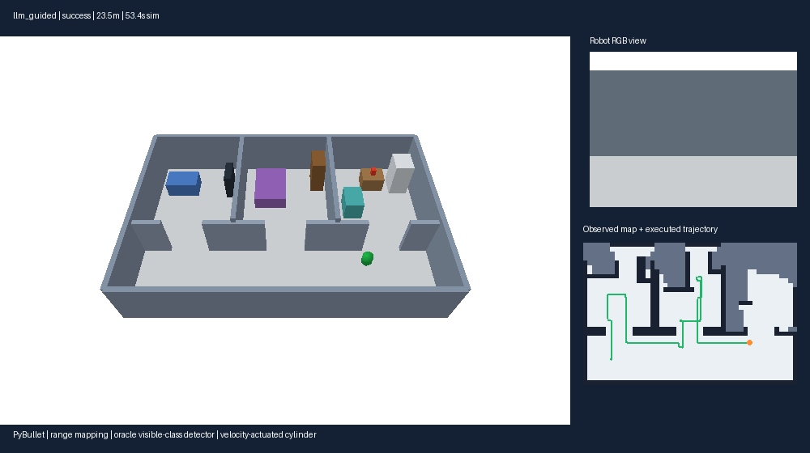

# PyBullet 三维地图与 C 决策演示

这是在现有契约上新增的三维测试入口，不替换原来的 synthetic case，也没有将生产 `EpisodeRunner` 标为完成。

## 看什么

- 12×8 m 三房间地图：公共走廊、三个门口、墙体、家具和杯子。
- 绿色圆柱机器人通过速度指令在 PyBullet 中移动，不用 teleport 执行路线。
- 左侧是第三人称三维场景；右上是机器人相机最近一帧；右下是观测地图和实际轨迹。
- 灰色未知区域不会被规划器当作空闲；相机看不到的杯子不会提前出现在策略输入。
- 两帧实际渲染可见证据触发目标声明；移动中发现目标会取消当前导航。

直接查看已导出的动画：[nearest](../pybullet_demo/nearest.gif)、[Gemini](../pybullet_demo/llm_guided.gif)。[决策记录与结果](../pybullet_demo/results.json)包含真实模型理由和执行指标。

2026-09-30 实测：

| 条件 | 终止 | 决策数 | 实际移动 | 障碍接触步数 | LLM fallback |
|---|---|---:|---:|---:|---:|
| nearest | success | 6 | 27.434 m | 0 | 0 |
| Gemini 3.8 Flash | success | 5 | 23.536 m | 0 | 0 |
| nearest，目标门封闭 | no_frontiers | 6 | 27.434 m | 0 | 0 |

两条成功轨迹都在行进/观测中取得了两帧杯子可见证据。负例没有杯子观测，也没有成功声明。物理接触单元测试单独强制机器人向封闭门移动，确认接触会被记录且机器人不能穿墙。共 24 项测试通过。



## 运行

当前工作区依赖已安装到 `.venv`。在 `D:\CS5478_PROJECT\integration`：

```powershell
.\scripts\run_pybullet_demo.ps1 -Policy nearest -Gui
.\scripts\run_pybullet_demo.ps1 -Policy llm_guided -Gui
```

不加 `-Gui` 时无需窗口，仍会导出动画。默认每次生成新的 `runs/pybullet-时间戳`，其中：

| 文件 | 内容 |
|---|---|
| `nearest.gif` / `llm_guided.gif` | 约每仿真秒采样的加速演示，含停留的最终状态 |
| `*-start.png` / `*-final.png` | 初始/最终画面 |
| `*.jsonl` | 状态、B 的代价、候选选择、原始模型响应、执行反馈与评分 |
| `*-summary.json` | 决策次数、实际距离、时间、接触计数、fallback 等 |

Gemini 读取仓库 `.env`；若不存在，启动脚本读取上一级已有 `.env`。密钥不进入日志。

## 观测、决策和反馈如何产生

1. 水平 720 条射线，量程 4 m，从物理场景的命中结果累积占据栅格，分辨率 0.25 m。命中坐标偏入物体表面再量化，避免边界落在空闲侧。
2. 按区域对已知空闲/未知边界进行四邻接聚类。候选接近点放在已知空闲、可达且有净空的位置。信息增益目前只是 frontier 支持面积代理值，不是正式的相机可见未知面积估计。
3. B 替身对未知/障碍膨胀一格，BFS 计算路径；nearest 最小化路径代价，Gemini 通过同一 `SelectionContext` 选择。
4. 每个物理步读实际机器人位置累计距离，读取 PyBullet 接触点；按法向力统计有效障碍接触，地板接触不计入。
5. 移动中定期刷新观测、复查剩余路径；发现阻塞时停止。到达还需旋转到目标 heading，然后做全景观察。
6. 可见目标使用两个不同采集序列确认；评分依据保留的渲染可见记录，结果不返回策略。

## 简化与边界

这是 `pybullet_procedural` 测试条件：手工构建场景，**不是真实房间扫描或 iGibson 数据集**。语义检测显式使用渲染 segmentation ID 对可见物体查询类别与精确位置，即 oracle-visible-class 替身；未接 YOLO。建图使用水平测距射线，未实现 RGB-D 高度净空融合。相机为虚拟全景扫描，机器人为速度驱动的全向圆柱，未建轮式底盘和驱动器。

区域多边形是允许先验；标准 room_type 保持 None。沿用契约字段 `igibson_room_prior` 表示区域先验，但此次来源是程序生成的几何，日志和报告明确区分。frontier 身份仅做简单支持格重叠匹配，未完成分裂合并谱系恢复；导航失败立即结束此 demo，不代表正式恢复策略。无有效候选只代表当前 demo 无可选点，不能证明目标不存在。

动画第三人称视图显示完整场景供人调试，策略只能接收传感器更新后的状态。单次 nearest/Gemini 路径差异不构成性能统计结论。

## 检查

```powershell
$env:PYTHONPATH = "$PWD/src"
.\.venv\Scripts\python.exe -m unittest discover -s tests -v
.\scripts\run_pybullet_demo.ps1 -Policy nearest -Blocked
```

可选物理测试检查初始目标不可见、候选路径不穿未知区、封闭门口产生真实接触并阻止机器人穿墙。未安装可选依赖时，这两项测试会跳过，其余原框架测试仍可运行。

PyBullet API 参考：[官方 Quickstart](https://github.com/bulletphysics/bullet3/blob/master/docs/pybullet_quickstart_guide/PyBulletQuickstartGuide.md.html)。
