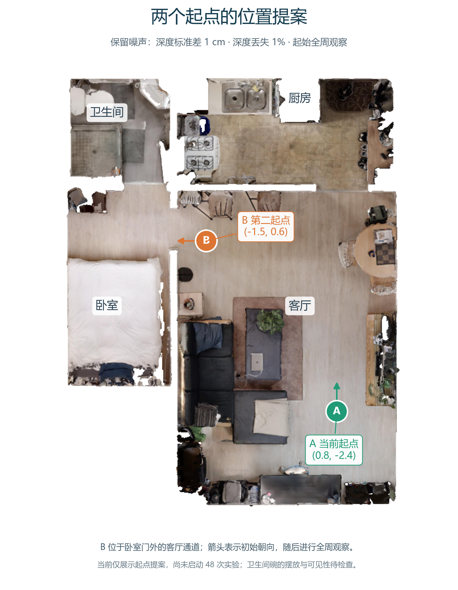

# 厨房语义目标检查（2026-11-09）

本文保留各阶段的摆放和启动检查记录。已完成实验的结果、最终配置和轨迹见[48轮中文报告](../../report/bowl-48-noise-20261110-02/README.md)。

本机资产与真实 Rs 渲染检查确认：**可优先使用厨房台面上的碗 `024_bowl`**，香蕉 `011_banana` 可作备用。两者都有纹理网格、碰撞网格，且现有 YOLO11s 支持 `bowl` / `banana` 类别。已安装的 `data/igibson-data` 中没有找到名称包含 `toothbrush` 的资产；检测器虽支持牙刷类别，目前仍缺可直接导入的牙刷模型。

碗与厨房有较强关联，但并非只会出现在厨房。可以用厨房典型位置检验语义先验，同时保留非典型位置对照，避免预设 LLM 必然占优。

## 已验证的摆放位置

使用 `apartment` 原始扫描公寓，不加动态推车；物体保持原始尺寸，以静态刚体摆放，与现有台面目标采用相同方式。坐标为 YCB 模型原点，单位米；四元数均为 `(0, 0, 0, 1)`。

| 目标 | 模型 | 原点位置 `(x, y, z)` | 碰撞包围盒尺寸 | 支撑检查 |
| --- | --- | --- | --- | --- |
| 碗 | `024_bowl` | `(-1.350241999, 2.951186498, 0.909709308)` | 约 16.6 × 16.5 × 5.9 cm | 9/9 点命中台面，高差 4.1 mm |
| 香蕉 | `011_banana` | `(-1.418712001, 2.961954997, 0.900191563)` | 约 11.4 × 18.2 × 4.1 cm | 9/9 点命中台面，高差 1.6 mm |

位置在厨房炉灶旁、水槽左侧的台面。物体碰撞 AABB 底部放在最高支撑点上方 2 mm。碗比旧杯子宽：以 `(-1.4, 2.95)` 为中心时，3 个边缘采样点未命中台面，因此按几何条件向内移动 5 cm 后才进行最终检测；不能直接沿用杯子坐标。

## 原生相机与检测检查

使用未修改的 Locobot `eyes` 相机、640 × 480、垂直视场 75°；RGB 检测使用现有 YOLO11s 和重叠切片，置信度阈值 0.50。分割真值仅用于离线匹配检测框，未输入检测器。下表置信度是与目标真值框 IoU ≥ 0.50 的检测中的最高值，**不是准确率或成功率**。

| 观察位置 | 碗 | 香蕉 | 物理检查 |
| --- | --- | --- | --- |
| 起点 `(0.8, -2.4)`，朝向 `π/2` | 0 个目标像素，无目标检测 | 0 个目标像素，无目标检测 | 无明显机器人穿模 |
| 厨房中部 `(-0.35, 2.15)`，朝向目标 | 590 像素，0.657 | 404 像素，0.759 | 无明显机器人穿模 |
| 厨房近处 `(-1.05, 2.15)`，朝向目标 | 1389 像素，0.804 | 742 像素，0.798 | 无明显机器人穿模 |

两个有效厨房姿态距目标约 1.28 m 和 0.85 m（碗）；近处距离适合后续验证项目的近距离验收。每个目标的 4 张移除目标对照画面中，均未出现该目标类别的检测（阈值 0.50）。厨房中部还能检测到 `oven`，起点可检测到 `refrigerator`，说明当前输入中确有部分厨房语义线索；仍需检查完整回合中这些线索进入哪个区域摘要、是否存在多个可选分支。

额外测试的入口姿态 `(0.4, 1.75)` 与扫描家具存在多处穿模，**不可作为可达观察位置或性能证据**，仅保留在诊断记录中。

这些姿态通过设置位置获得，未由机器人实际驶达。穿模检查使用真实机器人各 link 与扫描/目标之间的 Bullet 查询，统计高度超过 6 cm、穿透深度超过 2 mm 的接触。检查尚未验证完整路径、停车后的多帧定位、独立 W3 验收或 LLM 搜索优势。

## 复现与接入边界

新增脚本 [`check_semantic_targets.py`](../../scripts/perception/check_semantic_targets.py) 可复现摆放、原生渲染、RGB 检测和移除目标对照：

```powershell
# 使用已安装 iGibson、PyBullet 和 Ultralytics 的 Python；输出必须为新目录。
& $env:FRONTIER_PYTHON scripts/perception/check_semantic_targets.py --output runs/semantic-target-check-new
```

本次最终证据在 Git 忽略目录 `runs/semantic-target-check-20261109-v2/`：`report.json` 含完整精度的坐标、支撑点、姿态、检测框和置信度，`contact-sheet.png` 为总览，各目标/姿态包含原图与 `_absent.png` 对照。初次诊断目录 `runs/semantic-target-check-20261109/` 保留了碗边缘支撑不完整的旧位置，后续使用 v2。

初次资产检查时尚未接入新目标。随后已通过命名任务 `kitchen_bowl` 完成下列接入；不加 `--task` 时仍保留旧杯子设置：

- `simulation/rs_tasks.py`：统一定义目标模型、位置、类别和实例标识。
- `simulation/integrated_rs.py`：目标配置传入模拟器和真值标注，独立验收器接受对应目标类别。
- `runner/integrated.py`：manifest 与检测器使用相同目标类别；录制验证绑定目标、起点及观察设置。

新目标回合的多帧定位与 W3 验收尚需完整搜索验证；本轮按用户要求仅检查摆放与启动观察。

## 其他本地小物件与平面图

进一步清点确认，本机共有 21 个 YCB 模型，各自均有纹理、视觉网格和碰撞网格。除已验证的碗、香蕉及历史杯子外：

| 小物件 | 本地模型 | 适合尝试的地点 | 当前 YOLO11s 类别边界 |
| --- | --- | --- | --- |
| 剪刀（最长约 20 cm） | `037_scissors` | 书桌、工作台 | 有 `scissors`，尚未实测该模型的检测效果 |
| 芥末调味瓶（高约 19 cm） | `006_mustard_bottle` | 厨房台面、餐桌 | 只有通用 `bottle`，不能区分调味瓶与其他瓶子 |
| 清洁剂瓶（高约 25 cm） | `021_bleach_cleanser` | 卫生间或厨房清洁区 | 没有清洁剂专用类别；是否能识别为 `bottle` 待实测 |
| 咖啡罐、汤罐、金枪鱼罐、肉罐 | `002_master_chef_can`, `005_tomato_soup_can`, `007_tuna_fish_can`, `010_potted_meat_can` | 厨房台面、开放储物处 | 无对应罐头类别 |
| 饼干盒、糖盒、布丁盒、果冻盒 | `003_cracker_box`, `004_sugar_box`, `008_pudding_box`, `009_gelatin_box` | 厨房台面、开放储物处 | 无对应包装盒类别 |
| 记号笔（长约 12 cm） | `040_large_marker` | 书桌 | 无 `marker` / `pen` 类别 |
| 水壶（高约 24 cm） | `019_pitcher_base` | 厨房、餐桌 | 无 `pitcher` 类别 |
| 电钻、两个尺寸的夹具 | `035_power_drill`, `051_large_clamp`, `052_extra_large_clamp` | 工作台 | 无相应工具类别 |
| 木块、泡沫砖 | `036_wood_block`, `061_foam_brick` | 工作台 | 无相应类别，房间语义较弱 |

建议新类别首先尝试剪刀；若要卫生间专属目标，应另补牙刷模型。上表地点是待验证的摆放建议，未对这些新增候选做支撑、原生相机、检测或导航测试。尺寸来自原始视觉网格的轴对齐包围盒，和上文含 Bullet 碰撞裕量的尺寸不同。



图像来自 `data/igibson-data/g_dataset/Rs/floorplan.png`，使用 iGibson 的 `world_to_map` 变换，以世界坐标 +Y 向上、+X 向右显示；原始分辨率 0.01 m/像素，1000 × 1000，中心对应 `(0,0)`。房间名称是展示注释，不会自动传给策略；图中不含 `clutter` / `dynamic` 新增道具。这是场景参考俯视图，不是机器人探索得到的地图，白色缺失区不代表可通行。

## 厨房碗与卧室旁起点：完整一圈初始观察

新任务 `kitchen_bowl` 使用上文已验证的碗坐标。目前已按用户要求将机器人恢复到原始客厅起点 `(0.8, -2.4)` 米，固定初始 yaw 为 `π/2`。此前试跑使用的卧室旁起点 `(-1.5, 0.6)` 已停用。启动观察采用原有的 `allow_full_rotation=True`：按相对初始朝向的 90°、180°、270°、360° 依次转向并采集观测，最后回到初始朝向。先通过净空与旋转安全检查，才会执行完整转向。

因为正式搜索前已观察四周，本轮不再将“朝卧室 / 朝餐桌”作为两个实验条件，已移除 `--start-heading` 参数。全周观察仍可能因扫描顺序、遮挡和检测波动产生细微差别，因此统一固定一个朝向，方便复现。到达和恢复观察沿用原设置，不注入深度噪声。

在已安装 iGibson 的 Python 环境中，以下命令只检查摆放、出生点净空和原地全周观察，不执行搜索策略选择或驶向目标：

```powershell
python scripts/check_bowl_setup.py --output runs/bowl-setup-new
```

卧室旁旧起点的全周观察检查证据保留在 `runs/bowl-full-scan-check-20261109/`，不代表当前起点。该目录保存 manifest、首帧 RGB、观察结束 RGB、感知状态、事件及 setup 结果。检查通过要求：9 点支撑、可验证起始区域、初始观察完成、观察期间碗不可见、0 次搜索决策和 0 个碰撞控制步。日志中的 `externally_cancelled` 表示检查程序在初始观察完成后主动停止，不能计为一次搜索失败或搜索成功。

以后如需完整搜索（本轮未执行）：

```powershell
python scripts/run_integrated.py --task kitchen_bowl --policy nearest --no-noise --output runs/bowl-search
```

`kitchen_bowl` 默认使用 `apartment`，不加动态道具；可显式覆盖 `--profile`。不加 `--task` 时沿用旧杯子与动态场景默认值。录制验证同时绑定目标、起点和观察设置，有限扫描的旧证书不能用于当前全周扫描。

此前有限扫描的两种朝向检查及旧视角对照图保留在 `runs/bowl-start-check-20261109-v2/`，仅作为历史诊断，不代表当前启动流程。其初次目录 `runs/bowl-start-check-20261109/` 使用了错误的支撑射线过滤条件，应以 v2 为准。

## 原始起点的 36 回合带噪声基准

用户暂停卧室旁起点的 pilot，并要求恢复原始位置后运行 36 回合。旧 pilot 的 Nearest 和 Information Gain 已结束，Random 按指令取消，LLM 在启动前取消；所有日志保留在 `runs/bowl-noise-pilot-20261109-02/`，不并入新批次。

新批次：`runs/bowl-36-noise-20261109-01/`。

- 3 个场景条件：`apartment`、`clutter`、`dynamic`。
- 3 个种子块：17、29、43；4 种策略各 9 回合，共 36 回合。
- 所有回合固定起点 `(0.8, -2.4, 0, π/2)`，不再改变初始朝向。
- 目标、检测和独立验收统一为 `bowl` / `024_bowl`，厨房摆放坐标不变。
- 深度高斯标准差 0.01 m、深度丢失率 1%；噪声种子为基础种子 0 加环境种子，即 17、29、43。同一任务块的四种方法匹配。
- 单进程依次运行；每回合 600 仿真秒、18000 控制步、2400 墙钟秒。完整保存失败，不自动重试。
- LLM 使用已获用户批准的 Google Gemini 接口和配置模型 `gemini-3.5-flash-lite`。

本次 658 项回归通过，证书在 `runs/bowl-36-checks-20261109/tests.json`。三种场景均通过原生隔离可达性和近距离可见性预检查，证据在新批次的 `preflight/`。源码、模型、目标资产、36 份 manifest 和协议均已冻结并保存哈希。

实时报告：[本机实时页面](http://127.0.0.1:8910/?batch=36)，每 2 秒读取日志更新；`report/index.html` 是每约 25 秒生成的统计与证据报告。每回合结果在 `episodes/<job_id>/`，完整配对后再汇总比较。


## Configuration correction, 2026-11-10

The preceding batch was stopped and preserved as diagnostic data. Corrected batch: `runs/bowl-36-noise-20261110-02`. It restores the validated 5x5 depth filter, unvisited recovery viewpoints, inspection settling ratio 0.5, and noise seeds 140/152/166. Original start and kitchen bowl are fixed. Per-run trajectory PNGs remain enabled. Explicit payload/destination authorization was received on 10 November and the LLM queue launch was approved. At the user's subsequent request, up to two cases now run concurrently: one baseline and one LLM case; execution-amendment.json records shared-resource wall-time interpretation.


## New 48-run benchmark, 10 November

Current batch: `runs/bowl-48-noise-20261110-02`. Two starts A/B, three profiles, four methods, kitchen/bathroom bowl: 48 fresh runs, kitchen 24 first, at most two concurrent cases. Seeds held at 17/10017/20017; actual noise seed 140, depth std 0.01 m and dropout 1%. The validated filter/recovery/settling settings are retained. Before any search ran, original layout preflight found the added chair at (-2.70,1.0) blocked the bathroom route in clutter. The scoped `bowl48_accessible` layout moves only that chair to (-3.35,0.85), identically for both target locations and all methods; legacy defaults are preserved. Initial failed physical setup is retained under `bowl-48-noise-20261110-01`. New source passed 663 tests before freezing. Twelve target/start/profile physical prechecks gate the search queue; every completed outcome and per-run trajectory PNG is retained. Live report: http://127.0.0.1:8910/?batch=48
