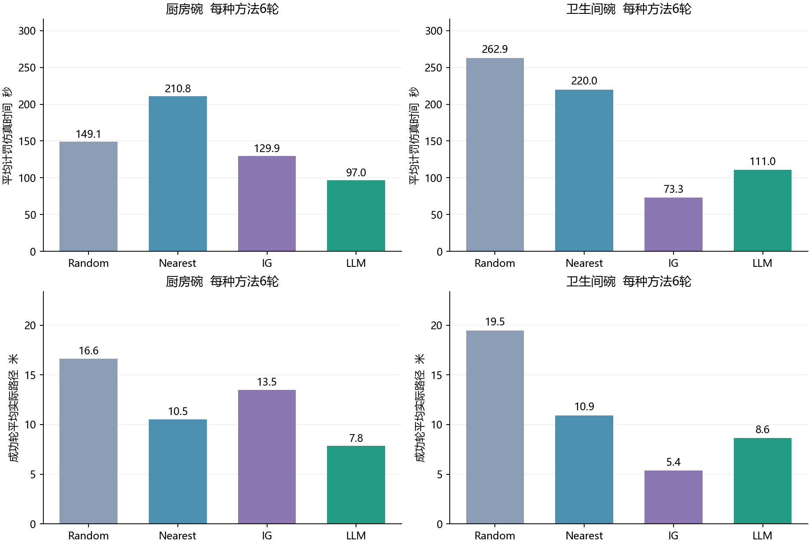
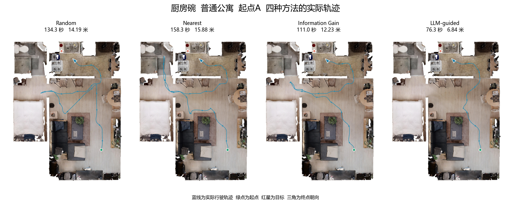
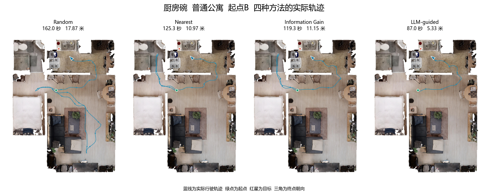
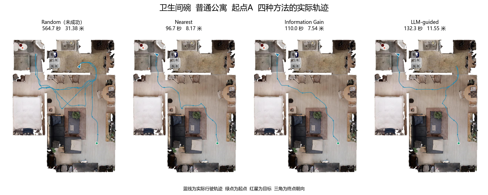
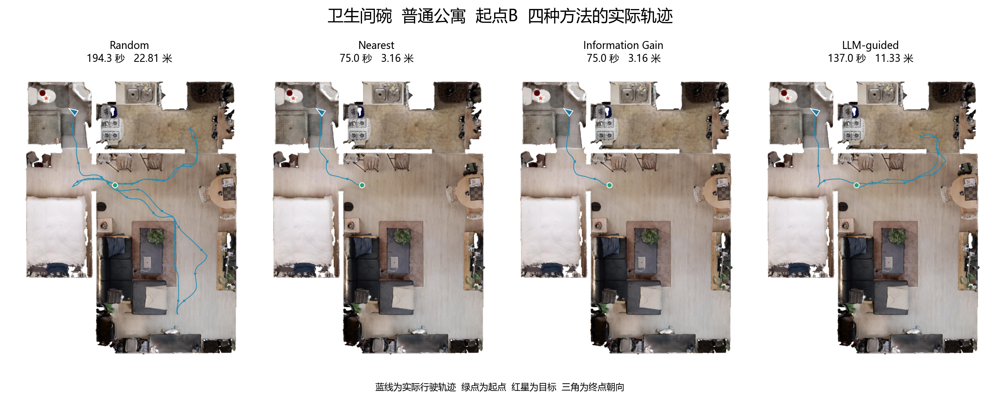

# 48轮有噪声碗搜索实验报告

面向项目组的结果汇总　实验完成日期 2026年11月10日　报告日期 2026年11月11日

本报告总结厨房和卫生间两处碗目标、两个起点、三种场景条件下四种搜索方法的48轮实验。共45轮成功，全部无碰撞；LLM-guided与Information Gain均为12/12成功。LLM在厨房任务中用时更少、路径更短，而卫生间任务由Information Gain表现更好。整体上，LLM的路径均值最短，IG的时间均值最低，现有配对区间不足以确认两者整体效率存在稳定差异。

## 实验设置与比较范围

| 项目 | 本次设置 |
| --- | --- |
| 任务规模 | 2处目标 × 2个起点 × 3种条件 × 4种方法 = 48轮 |
| 目标 | 每轮仅一个YCB碗024_bowl，位于厨房台面或卫生间马桶盖上 |
| 起点A | 客厅原起点  x=0.8 m，y=−2.4 m，初始朝向90° |
| 起点B | 客厅靠卧室门  x=−1.5 m，y=0.6 m，初始朝向180° |
| 场景条件 | 普通公寓；新增家具的拥挤场景；带移动推车的动态障碍场景 |
| 方法 | Random、Nearest、Information Gain、LLM-guided |
| 噪声 | 深度高斯噪声标准差0.01 m；深度丢失概率1%；实际噪声种子140 |
| 其他种子 | 环境17；感知10017；策略20017，均固定 |
| 模型 | gemini-3.5-flash-lite |
| 共同预算 | 最多600仿真秒、18000控制步、80次决策、45次尝试；墙钟上限2400秒 |
| 执行顺序 | 厨房24轮先运行，随后卫生间24轮；最多两轮并发 |

各方法共享感知、导航、目标接近与成功验收流程，启动时执行完整一周观察。LLM接收已观察物体类别与坐标、候选点、路径代价和执行反馈；不直接接收RGB图像、隐藏地图或目标真实位置。12组物理可行性预检查均通过；卧室门旁起点的卫生间启动检查中，40帧均未看到目标像素，也未形成碗轨迹。

本次采用bowl48_accessible布局。为保证卫生间可达，拥挤与动态场景中原位于(−2.70, 1.0)的新增椅子统一移至(−3.35, 0.85)。该布局同时用于厨房和卫生间任务及全部方法。未运行搜索的旧准备批次保留在记录中；本报告仅使用正式完成的20261110-02批次。

## 指标定义与整体结果

成功率按全部轮次统计。平均计罚时间对每个失败统一记600秒，防止提前失败看起来更快。成功轮时间和路径只对各方法成功的轮次求均值，因此样本集合可能不同；公平的同任务效率比较另列在配对分析中。路径来自实际运动记录。仿真时间不等于模型调用或整个程序的墙钟耗时；本机并发运行的墙钟时间不作为独占硬件速度结论。

| 方法 | 成功 | 计罚时间 秒 | 成功时间 秒 | 成功路径 米 |
| --- | --- | --- | --- | --- |
| Random | 11/12 | 206.0 | 170.2 | 17.93 |
| Nearest | 10/12 | 215.4 | 138.5 | 10.74 |
| Information Gain | 12/12 | 101.6 | 101.6 | 9.44 |
| LLM-guided | 12/12 | 104.0 | 104.0 | 8.24 |

与IG相比，LLM的平均路径由9.44米降至8.24米，缩短12.6%；平均计罚时间由101.6秒增至104.0秒，增加2.4%。与Random和Nearest相比，LLM的计罚时间均值分别降低49.5%和51.7%，但这两项差异包含失败被计600秒的影响，不能直接解释为成功搜索速度提高同样比例。

## 目标位置改变了方法排序

### 厨房碗

| 方法 | 成功 | 计罚时间 秒 | 成功时间 秒 | 成功路径 米 |
| --- | --- | --- | --- | --- |
| Random | 6/6 | 149.1 | 149.1 | 16.65 |
| Nearest | 5/6 | 210.8 | 133.0 | 10.54 |
| Information Gain | 6/6 | 129.9 | 129.9 | 13.49 |
| LLM-guided | 6/6 | 97.0 | 97.0 | 7.84 |

### 卫生间碗

| 方法 | 成功 | 计罚时间 秒 | 成功时间 秒 | 成功路径 米 |
| --- | --- | --- | --- | --- |
| Random | 5/6 | 262.9 | 195.5 | 19.48 |
| Nearest | 5/6 | 220.0 | 144.0 | 10.93 |
| Information Gain | 6/6 | 73.3 | 73.3 | 5.38 |
| LLM-guided | 6/6 | 111.0 | 111.0 | 8.65 |

厨房的6组任务中，LLM与IG均全部成功，LLM平均时间减少25.4%，路径缩短41.9%。卫生间的6组任务中，两者也均全部成功，但LLM比IG耗时多51.5%、路径长60.6%。因此，厨房结果中的优势不能直接推广到卫生间。目标位置同时改变可见性、几何路线和语义关联，当前实验不能单独识别“房间常识”造成的效果。

图1 两处目标的平均计罚时间与成功轮路径。每种方法每处目标6轮，路径均值的成功样本数见表。

## 起点与场景条件

| 起点 | 方法 | 成功 | 计罚时间 秒 | 成功时间 秒 | 成功路径 米 |
| --- | --- | --- | --- | --- | --- |
| A | Random | 5/6 | 228.9 | 154.6 | 15.50 |
| A | Nearest | 6/6 | 156.3 | 156.3 | 12.89 |
| A | Information Gain | 6/6 | 110.3 | 110.3 | 11.13 |
| A | LLM-guided | 6/6 | 114.6 | 114.6 | 9.07 |
| B | Random | 6/6 | 183.2 | 183.2 | 19.96 |
| B | Nearest | 4/6 | 274.6 | 111.8 | 7.50 |
| B | Information Gain | 6/6 | 92.9 | 92.9 | 7.75 |
| B | LLM-guided | 6/6 | 93.4 | 93.4 | 7.41 |

起点B处，LLM与IG的平均时间接近，分别为93.4秒与92.9秒，路径分别为7.41米与7.75米。Nearest的两次失败均发生在起点B的拥挤场景。这里比较的是相同房屋中的两个固定起点，并非对全部可能起点的估计。

| 条件 | 方法 | 成功 | 计罚时间 秒 | 成功时间 秒 | 成功路径 米 |
| --- | --- | --- | --- | --- | --- |
| 普通公寓 | Random | 3/4 | 272.7 | 163.6 | 18.29 |
| 普通公寓 | Nearest | 4/4 | 113.8 | 113.8 | 9.55 |
| 普通公寓 | Information Gain | 4/4 | 103.8 | 103.8 | 8.52 |
| 普通公寓 | LLM-guided | 4/4 | 108.2 | 108.2 | 8.76 |
| 拥挤场景 | Random | 4/4 | 173.4 | 173.4 | 18.80 |
| 拥挤场景 | Nearest | 2/4 | 386.9 | 173.8 | 10.89 |
| 拥挤场景 | Information Gain | 4/4 | 98.4 | 98.4 | 9.72 |
| 拥挤场景 | LLM-guided | 4/4 | 91.2 | 91.2 | 6.89 |
| 动态障碍 | Random | 4/4 | 172.0 | 172.0 | 16.80 |
| 动态障碍 | Nearest | 4/4 | 145.5 | 145.5 | 11.85 |
| 动态障碍 | Information Gain | 4/4 | 102.6 | 102.6 | 10.06 |
| 动态障碍 | LLM-guided | 4/4 | 112.7 | 112.7 | 9.07 |

LLM在拥挤条件的平均时间和成功路径均最低；普通和动态条件的时间均值由IG最低。各条件只有每种方法4轮，不能仅凭“拥挤”或“动态”标签预期方法一定更慢。新增家具改变初始可见范围、候选点集合和后续路线，任务难度可能出现非单调变化。

## 配对分析与不确定性

| 基线与LLM | 共同成功配对数 | 平均时间 秒 | 平均路径 米 |
| --- | --- | --- | --- |
| Random / LLM | 11 | 170.2 / 101.4 | 17.93 / 7.94 |
| Nearest / LLM | 10 | 138.5 / 111.7 | 10.74 / 8.91 |
| Information Gain / LLM | 12 | 101.6 / 104.0 | 9.44 / 8.24 |

| 差值方向 | 配对数 | 时间差及95%区间 秒 | 路径差及95%区间 米 |
| --- | --- | --- | --- |
| Random − LLM | 11 | 68.78 [25.99, 118.14] | 9.99 [4.95, 15.15] |
| Nearest − LLM | 10 | 26.77 [-3.07, 58.40] | 1.83 [-1.63, 5.69] |
| Information Gain − LLM | 12 | -2.39 [-28.53, 22.36] | 1.19 [-1.71, 4.19] |

正差值表示基线用时更长或路径更长。区间来自既有报告按场景条件分层、对目标与起点配对组进行的重采样，仅描述这套固定房屋中的任务变化。IG与LLM的时间和路径差区间均跨过零，Nearest与LLM在共同成功任务中的差异区间也跨过零。Random与LLM的共同成功配对中，两项差异区间均为正。成功率比较中，所有涉及LLM的Holm校正McNemar检验p值均为1.0，不能把12/12对11/12或10/12解释为已证实的成功率优势。

## 轨迹观察与决策解释

以下四组示例覆盖普通公寓中厨房与卫生间两个目标位置、起点A与起点B的全部组合，便于观察目标与起点改变后的路线。它们用于说明行为，整体结论仍依据全部12组配对。背景由原始Rs平面图与仿真器实际渲染的新增物体图层合成；动态场景的推车显示初始位置。所有48轮均另存了带场景物体的trajectory-scene.png。

图2 厨房碗与起点A的四方法轨迹。图中给出的耗时为该轮实际仿真时间，路径为该轮实际行驶距离。

图3 厨房碗与起点B的四方法轨迹。四种方法均成功；LLM该轮耗时87.0秒，实际路径5.33米。

图4 卫生间碗与起点A的四方法轨迹。Random以search_limit终止，未成功；图中564.7秒和31.38米是失败前的实际记录，主结果对该轮计罚600秒。其余三种方法均成功。

图5 卫生间碗与起点B的四方法轨迹。该普通公寓实例中，LLM先探索餐桌方向，随后返回卫生间。

| 卫生间起点B | LLM初始搜索方向 | 实际时间 秒 | 实际路径 米 |
| --- | --- | --- | --- |
| 普通公寓 | 先餐桌方向，后卫生间 | 137.0 | 11.33 |
| 拥挤场景 | 先朝卫生间方向探索 | 47.0 | 3.02 |
| 动态障碍 | 先朝卫生间方向探索 | 47.0 | 3.02 |

起点B的3轮卫生间LLM任务中，拥挤和动态两轮先朝卫生间方向，均为47.0秒、3.02米，并与对应IG路线及指标一致。普通公寓轮先探索餐桌方向，为137.0秒、11.33米；对应IG为75.0秒、3.16米。这三轮首次LLM输入均没有碗观测。两次直接朝卫生间行进的LLM理由主要强调信息增益与路径代价，因此不能单凭短路线证明模型推断出了卫生间中的碗。

当前信息增益是从候选观测位置预计可见的未知网格面积；已知障碍会挡住预测视线。IG策略按“信息增益／路径代价加小常数”排序。起点B的卫生间方向候选在普通与拥挤场景中均为4.11平方米增益、1.31米路径代价，而餐桌方向的候选集合随家具变化。普通公寓LLM选择餐桌方向时，其增益代价比约1.63，低于卫生间方向约2.91，说明LLM选择并非始终等于IG排序。区域描述还把餐桌、马桶等类别混在一个较大区域中，限制了语义与具体方向的准确关联。

## 失败案例与模型调用

| 目标 | 条件 | 起点 | 方法 | 终止原因 | 实际秒 | 实际米 |
| --- | --- | --- | --- | --- | --- | --- |
| 厨房 | 拥挤场景 | B | Nearest | no_feasible_frontiers | 76.7 | 2.42 |
| 卫生间 | 普通公寓 | A | Random | search_limit | 564.7 | 31.38 |
| 卫生间 | 拥挤场景 | B | Nearest | no_feasible_frontiers | 76.7 | 2.42 |

no_feasible_frontiers表示当时没有可执行的候选点，不能据此断言整个房屋或目标在物理上不可达；它可能与观测地图、导航可行性及恢复流程有关。search_limit是搜索预算类终止标签，也不必然意味着恰好耗尽600仿真秒。上述三个失败均按既定规则保留，没有重跑替换。当前汇总未逐一完成失败根因重建，因此不将失败归因于特定感知或规划错误。

LLM共调用36次，发生1次客户端运行错误回退，占2.8%；该回退位于卫生间、动态场景、起点A。其余轮次无回退，全部LLM轮次最终成功。调用延迟中位数为2.80秒，95百分位为7.76秒，记录的总token数为309,417。结果未记录货币费用，不能将记录中的零费用解释为免费。

## 结论与下一步

这批实验支持的结论是：LLM在厨房碗任务中减少了搜索时间和行驶距离，并在全部12轮保持成功；其整体路径均值优于IG，但卫生间任务显著削弱了时间优势。报告应同时呈现这两个目标位置的结果，避免仅用厨房案例概括LLM的表现。

优先改进方向是让候选点获得更局部、准确的物体关联，并单独分析Nearest在拥挤起点B的两次无可行候选终止。如果测试更重视语义的提示词，应将其定义为新的方法变体，在厨房和卫生间任务上统一验证。后续增加独立噪声实现或不同房屋，才能更可靠地评价稳定性和泛化。历史杯子与36轮厨房碗实验采用不同任务分组和部分布局设置，本报告不将它们与本次48轮合并统计。

## 逐轮结果与数据来源

下表列出全部48轮实际结束时间与路径；失败项在主结果中的计罚时间另按600秒处理。每个任务块的四行具有相同目标、起点、场景和种子。

| 目标 | 条件 | 起点 | 方法 | 结果 | 实际秒 | 实际米 |
| --- | --- | --- | --- | --- | --- | --- |
| 厨房 | 普通公寓 | A | Random | 成功 | 134.3 | 14.19 |
| 厨房 | 普通公寓 | A | Nearest | 成功 | 158.3 | 15.88 |
| 厨房 | 普通公寓 | A | Information Gain | 成功 | 111.0 | 12.23 |
| 厨房 | 普通公寓 | A | LLM-guided | 成功 | 76.3 | 6.84 |
| 厨房 | 拥挤场景 | A | Random | 成功 | 161.3 | 18.87 |
| 厨房 | 拥挤场景 | A | Nearest | 成功 | 92.7 | 6.58 |
| 厨房 | 拥挤场景 | A | Information Gain | 成功 | 143.7 | 15.97 |
| 厨房 | 拥挤场景 | A | LLM-guided | 成功 | 68.7 | 6.23 |
| 厨房 | 动态障碍 | A | Random | 成功 | 185.7 | 21.65 |
| 厨房 | 动态障碍 | A | Nearest | 成功 | 88.7 | 6.42 |
| 厨房 | 动态障碍 | A | Information Gain | 成功 | 136.3 | 15.44 |
| 厨房 | 动态障碍 | A | LLM-guided | 成功 | 107.7 | 6.87 |
| 厨房 | 普通公寓 | B | Random | 成功 | 162.0 | 17.87 |
| 厨房 | 普通公寓 | B | Nearest | 成功 | 125.3 | 10.97 |
| 厨房 | 普通公寓 | B | Information Gain | 成功 | 119.3 | 11.15 |
| 厨房 | 普通公寓 | B | LLM-guided | 成功 | 87.0 | 5.33 |
| 厨房 | 拥挤场景 | B | Random | 成功 | 152.0 | 18.79 |
| 厨房 | 拥挤场景 | B | Nearest | no_feasible_frontiers | 76.7 | 2.42 |
| 厨房 | 拥挤场景 | B | Information Gain | 成功 | 125.0 | 12.10 |
| 厨房 | 拥挤场景 | B | LLM-guided | 成功 | 83.7 | 6.84 |
| 厨房 | 动态障碍 | B | Random | 成功 | 99.3 | 8.50 |
| 厨房 | 动态障碍 | B | Nearest | 成功 | 200.0 | 12.86 |
| 厨房 | 动态障碍 | B | Information Gain | 成功 | 144.3 | 14.03 |
| 厨房 | 动态障碍 | B | LLM-guided | 成功 | 158.7 | 14.93 |
| 卫生间 | 普通公寓 | A | Random | search_limit | 564.7 | 31.38 |
| 卫生间 | 普通公寓 | A | Nearest | 成功 | 96.7 | 8.17 |
| 卫生间 | 普通公寓 | A | Information Gain | 成功 | 110.0 | 7.54 |
| 卫生间 | 普通公寓 | A | LLM-guided | 成功 | 132.3 | 11.55 |
| 卫生间 | 拥挤场景 | A | Random | 成功 | 192.3 | 13.89 |
| 卫生间 | 拥挤场景 | A | Nearest | 成功 | 255.0 | 15.20 |
| 卫生间 | 拥挤场景 | A | Information Gain | 成功 | 78.0 | 7.80 |
| 卫生间 | 拥挤场景 | A | LLM-guided | 成功 | 165.3 | 11.49 |
| 卫生间 | 动态障碍 | A | Random | 成功 | 99.6 | 8.91 |
| 卫生间 | 动态障碍 | A | Nearest | 成功 | 246.3 | 25.09 |
| 卫生间 | 动态障碍 | A | Information Gain | 成功 | 82.7 | 7.76 |
| 卫生间 | 动态障碍 | A | LLM-guided | 成功 | 137.3 | 11.47 |
| 卫生间 | 普通公寓 | B | Random | 成功 | 194.3 | 22.81 |
| 卫生间 | 普通公寓 | B | Nearest | 成功 | 75.0 | 3.16 |
| 卫生间 | 普通公寓 | B | Information Gain | 成功 | 75.0 | 3.16 |
| 卫生间 | 普通公寓 | B | LLM-guided | 成功 | 137.0 | 11.33 |
| 卫生间 | 拥挤场景 | B | Random | 成功 | 188.0 | 23.65 |
| 卫生间 | 拥挤场景 | B | Nearest | no_feasible_frontiers | 76.7 | 2.42 |
| 卫生间 | 拥挤场景 | B | Information Gain | 成功 | 47.0 | 3.02 |
| 卫生间 | 拥挤场景 | B | LLM-guided | 成功 | 47.0 | 3.02 |
| 卫生间 | 动态障碍 | B | Random | 成功 | 303.3 | 28.13 |
| 卫生间 | 动态障碍 | B | Nearest | 成功 | 47.0 | 3.02 |
| 卫生间 | 动态障碍 | B | Information Gain | 成功 | 47.0 | 3.02 |
| 卫生间 | 动态障碍 | B | LLM-guided | 成功 | 47.0 | 3.02 |

本报告直接读取冻结批次的results.json、protocol.json、逐轮summary.json和记录轨迹生成。套件校验确认48轮齐全、12组配对完整、冻结源代码与共享资产未变、所有结果完整性检查通过。实验后生成的可视化不会影响搜索决策或指标。HTML内嵌本报告的五张图，可独立分享；逐轮证据链接需保留原实验目录结构。

[完整统计JSON](../results.json)

[逐轮CSV](../episodes.csv)

[冻结实验配置](../protocol.json)

[实验完整性校验](../suite-verification.json)

[48张场景轨迹图导出状态](../trajectory-scene-status.json)

### 逐轮轨迹图索引

仓库存档中的逐轮轨迹使用WebP预览；完整分辨率PNG保留在原实验目录。WebP仅用于展示，统计数据与逐轮JSON均直接复制自原结果。

[kitchen-apartment-startA-random](../episodes/kitchen-apartment-startA-random/trajectory-scene.webp)

[kitchen-apartment-startA-nearest](../episodes/kitchen-apartment-startA-nearest/trajectory-scene.webp)

[kitchen-apartment-startA-information_gain](../episodes/kitchen-apartment-startA-information_gain/trajectory-scene.webp)

[kitchen-apartment-startA-llm_guided](../episodes/kitchen-apartment-startA-llm_guided/trajectory-scene.webp)

[kitchen-clutter-startA-random](../episodes/kitchen-clutter-startA-random/trajectory-scene.webp)

[kitchen-clutter-startA-nearest](../episodes/kitchen-clutter-startA-nearest/trajectory-scene.webp)

[kitchen-clutter-startA-information_gain](../episodes/kitchen-clutter-startA-information_gain/trajectory-scene.webp)

[kitchen-clutter-startA-llm_guided](../episodes/kitchen-clutter-startA-llm_guided/trajectory-scene.webp)

[kitchen-dynamic-startA-random](../episodes/kitchen-dynamic-startA-random/trajectory-scene.webp)

[kitchen-dynamic-startA-nearest](../episodes/kitchen-dynamic-startA-nearest/trajectory-scene.webp)

[kitchen-dynamic-startA-information_gain](../episodes/kitchen-dynamic-startA-information_gain/trajectory-scene.webp)

[kitchen-dynamic-startA-llm_guided](../episodes/kitchen-dynamic-startA-llm_guided/trajectory-scene.webp)

[kitchen-apartment-startB-random](../episodes/kitchen-apartment-startB-random/trajectory-scene.webp)

[kitchen-apartment-startB-nearest](../episodes/kitchen-apartment-startB-nearest/trajectory-scene.webp)

[kitchen-apartment-startB-information_gain](../episodes/kitchen-apartment-startB-information_gain/trajectory-scene.webp)

[kitchen-apartment-startB-llm_guided](../episodes/kitchen-apartment-startB-llm_guided/trajectory-scene.webp)

[kitchen-clutter-startB-random](../episodes/kitchen-clutter-startB-random/trajectory-scene.webp)

[kitchen-clutter-startB-nearest](../episodes/kitchen-clutter-startB-nearest/trajectory-scene.webp)

[kitchen-clutter-startB-information_gain](../episodes/kitchen-clutter-startB-information_gain/trajectory-scene.webp)

[kitchen-clutter-startB-llm_guided](../episodes/kitchen-clutter-startB-llm_guided/trajectory-scene.webp)

[kitchen-dynamic-startB-random](../episodes/kitchen-dynamic-startB-random/trajectory-scene.webp)

[kitchen-dynamic-startB-nearest](../episodes/kitchen-dynamic-startB-nearest/trajectory-scene.webp)

[kitchen-dynamic-startB-information_gain](../episodes/kitchen-dynamic-startB-information_gain/trajectory-scene.webp)

[kitchen-dynamic-startB-llm_guided](../episodes/kitchen-dynamic-startB-llm_guided/trajectory-scene.webp)

[bathroom-apartment-startA-random](../episodes/bathroom-apartment-startA-random/trajectory-scene.webp)

[bathroom-apartment-startA-nearest](../episodes/bathroom-apartment-startA-nearest/trajectory-scene.webp)

[bathroom-apartment-startA-information_gain](../episodes/bathroom-apartment-startA-information_gain/trajectory-scene.webp)

[bathroom-apartment-startA-llm_guided](../episodes/bathroom-apartment-startA-llm_guided/trajectory-scene.webp)

[bathroom-clutter-startA-random](../episodes/bathroom-clutter-startA-random/trajectory-scene.webp)

[bathroom-clutter-startA-nearest](../episodes/bathroom-clutter-startA-nearest/trajectory-scene.webp)

[bathroom-clutter-startA-information_gain](../episodes/bathroom-clutter-startA-information_gain/trajectory-scene.webp)

[bathroom-clutter-startA-llm_guided](../episodes/bathroom-clutter-startA-llm_guided/trajectory-scene.webp)

[bathroom-dynamic-startA-random](../episodes/bathroom-dynamic-startA-random/trajectory-scene.webp)

[bathroom-dynamic-startA-nearest](../episodes/bathroom-dynamic-startA-nearest/trajectory-scene.webp)

[bathroom-dynamic-startA-information_gain](../episodes/bathroom-dynamic-startA-information_gain/trajectory-scene.webp)

[bathroom-dynamic-startA-llm_guided](../episodes/bathroom-dynamic-startA-llm_guided/trajectory-scene.webp)

[bathroom-apartment-startB-random](../episodes/bathroom-apartment-startB-random/trajectory-scene.webp)

[bathroom-apartment-startB-nearest](../episodes/bathroom-apartment-startB-nearest/trajectory-scene.webp)

[bathroom-apartment-startB-information_gain](../episodes/bathroom-apartment-startB-information_gain/trajectory-scene.webp)

[bathroom-apartment-startB-llm_guided](../episodes/bathroom-apartment-startB-llm_guided/trajectory-scene.webp)

[bathroom-clutter-startB-random](../episodes/bathroom-clutter-startB-random/trajectory-scene.webp)

[bathroom-clutter-startB-nearest](../episodes/bathroom-clutter-startB-nearest/trajectory-scene.webp)

[bathroom-clutter-startB-information_gain](../episodes/bathroom-clutter-startB-information_gain/trajectory-scene.webp)

[bathroom-clutter-startB-llm_guided](../episodes/bathroom-clutter-startB-llm_guided/trajectory-scene.webp)

[bathroom-dynamic-startB-random](../episodes/bathroom-dynamic-startB-random/trajectory-scene.webp)

[bathroom-dynamic-startB-nearest](../episodes/bathroom-dynamic-startB-nearest/trajectory-scene.webp)

[bathroom-dynamic-startB-information_gain](../episodes/bathroom-dynamic-startB-information_gain/trajectory-scene.webp)

[bathroom-dynamic-startB-llm_guided](../episodes/bathroom-dynamic-startB-llm_guided/trajectory-scene.webp)
