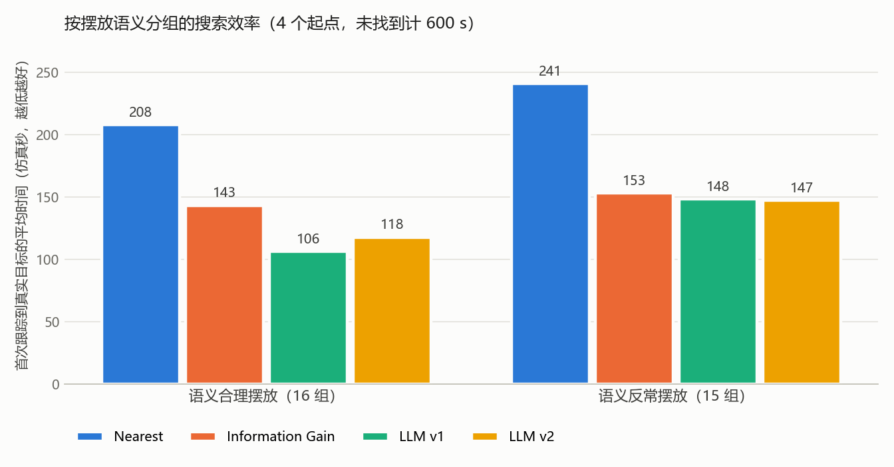

# LLM 语义引导前沿探索：重复实验结论

## 1. 实验设置

- **场景**：iGibson Rs 公寓，4 个区域（R1 客厅/书桌，R2，R3 浴室，R4 厨房）。房间类型对策略隐藏，只能从已观测物体推断。
- **任务**：4 种 YCB 物体（剪刀、杯子、瓶子、香蕉），各放在一个语义合理和一个语义反常的位置，共 8 个任务。
- **起点**：4 个起点（S0–S3），每个起点都通过预检：0.65 m 出生区安全、目标可达、从起点看不到目标、近距离 YOLO 与真值框匹配。S3 去掉了 bottle-bathroom，因为从 S3 起点就能直接看到目标。共 31 个（起点，任务）组合。
- **策略**（每个组合 4 种策略都跑，共 124 个回合）：
  - `nearest`：选路径最近的前沿；
  - `information_gain`（IG）：选信息增益最大的前沿；
  - `llm_guided`（v1）：DeepSeek-V4.1-Flash（`deepseek-flash`），原始系统提示词；
  - `llm_guided_v2`：同一模型，改进后的结构化提示词，提示词本身不含任何任务答案（见第 4 节）。
- **终止条件**：仿真时间上限 600 s。判定成功需要两帧近距离、机器人静止、且与保留真值实例一致的检测证据。传感器无噪声，环境种子固定。
- **有效性**：511 次 LLM 调用中只有 2 次回退到 nearest，所有 LLM 回合的模型决策覆盖率都在 80% 以上，全部计为有效。早先的 Gemini 批次因免费额度（20 次/天）耗尽几乎全部回退，已整体作废，不纳入本文。

## 2. 主要结果

### 2.1 任务完成（失败按 600 s 计）

| 策略 | 成功率 | 平均有上限时间 | 成功回合平均时间 | 成功回合平均路程 | 误报 |
|---|---:|---:|---:|---:|---:|
| nearest | 7/31（23%） | 504 s | 174 s | 11.7 m | 3 |
| information_gain | 13/31（42%） | 415 s | 159 s | 13.7 m | 2 |
| LLM v1 | 14/31（45%） | 394 s | 144 s | 11.7 m | 4 |
| LLM v2 | 13/31（42%） | 402 s | 127 s | 9.8 m | 2 |

### 2.2 搜索效率：首次跟踪到真实目标的时间（与末端复核无关）

| 策略 | 找到目标 | 平均找到时间（未找到计 600 s） | 中位数 |
|---|---:|---:|---:|
| nearest | 24/31 | 224 s | 118 s |
| information_gain | 28/31 | 148 s | 113 s |
| LLM v1 | 29/31 | 127 s | 86 s |
| LLM v2 | 28/31 | 132 s | 76 s |

按语义关系分组的平均找到时间：

| 分组 | nearest | IG | LLM v1 | LLM v2 |
|---|---:|---:|---:|---:|
| 语义合理（16 组） | 208 s | 143 s | **106 s** | 118 s |
| 语义反常（15 组） | 241 s | 153 s | 148 s | 147 s |

### 2.3 配对比较（同一起点、同一任务；符号检验）

| 比较 | 指标 | 胜 / 平 / 负 | 平均差 | p |
|---|---|---|---:|---:|
| IG vs nearest | 找到时间 | 22 / 4 / 5 | −76 s | 0.002 |
| LLM v1 vs nearest | 找到时间 | 26 / 1 / 4 | −97 s | <0.001 |
| LLM v2 vs nearest | 找到时间 | 25 / 2 / 4 | −92 s | <0.001 |
| LLM v1 vs IG | 找到时间 | 15 / 7 / 9 | −21 s | 0.31 |
| LLM v2 vs IG | 找到时间 | 15 / 9 / 7 | −16 s | 0.13 |
| LLM v1 vs IG（仅语义合理） | 找到时间 | 9 / 2 / 5 | −37 s，95% CI [−112, +19] | 0.42 |
| LLM v1 vs IG（仅语义反常） | 找到时间 | 6 / 5 / 4 | −5 s | 0.75 |
| LLM v2 vs LLM v1 | 找到时间 | 10 / 15 / 6 | +5 s | 0.45 |
| LLM v1 vs IG | 任务完成 | 10 / 18 / 3 | −21 s | 0.09 |

## 3. 结论（可直接写入报告）

1. **语义/信息驱动的策略显著优于最近前沿。** IG、LLM v1、LLM v2 找到真实目标的速度都显著快于 nearest（配对符号检验 p ≤ 0.002，平均快 76–97 s），成功率也从 23% 提高到 42–45%。

2. **LLM 相对 IG 只有小幅优势，且在统计上不显著。** LLM v1 平均找到时间比 IG 少 21 s（127 s 对 148 s），任务完成上 10 胜 3 负，但 p = 0.09–0.31。31 个配对样本不足以支持"LLM 优于信息增益"的结论，只能说明方向一致的趋势。

3. **LLM 的优势集中在语义合理的摆放上，与语义先验的预期一致。** 目标在常见位置时（如厨房的杯子、香蕉），LLM v1 平均找到时间比 IG 少 26%（106 s 对 143 s）；目标在反常位置时（浴室的香蕉、厨房的剪刀）两者几乎一样（148 s 对 153 s）。LLM 在反常场景下没有明显变差，说明它不会被错误先验严重误导，但也说明它的优势依赖于"物体在常见位置"这个前提。这一组内差异同样不显著（p = 0.42），应写成"趋势"，不要写成"证明"。

4. **LLM 的决策中很大一部分只是复现几何启发式。** v1 有 44%、v2 有 52% 的决策正好选了"每米路径信息增益"最高的前沿。v2 输出的区域概率几乎不随目标类别变化：第一次决策时，剪刀、杯子、瓶子、香蕉对各区域的概率都约为 R3 0.31、R4 0.30；即使 R4 已经观测到冰箱、烤箱，v2 给 R4 的概率对杯子是 0.39、对剪刀是 0.36，区分很弱。概率主要跟随"哪个区域未探索的部分多"。因此 LLM 的文字理由虽然经常提到"推断为厨房"，但实际决策更接近"覆盖率加少量语义"。

5. **结构化提示词（v2）没有带来提升。** 在同一模型上，v2 对 v1 为 10 胜 15 平 6 负，平均慢 5 s（p = 0.45）。v2 成功回合的路程更短（9.8 m 对 11.7 m），但每次调用 token 更多、延迟更长（每次约 11–24 s，v1 约 7–10 s）。此外 v2 有 2 个回合因首选厨房入口前沿而陷入导航死角，51 s 就结束；1 个回合因调用超过模块 60 s 的监督时限被终止。这说明在当前感知和导航栈下，提示词工程的边际收益很小。

6. **主要瓶颈在末端复核和感知，不在高层选区。** 浴室和书桌上的 4 个任务中，所有策略在所有起点的成功率都是 0。这 58 个失败回合里有 54 个其实已经把真实目标跟踪到 0.5 m 以内，只是没能通过两帧近距离复核。全部 11 次误报都发生在瓶子任务上，4 种策略都有（nearest 3、IG 2、v1 4、v2 2），因为场景中还有其他瓶子，复核环节把干扰物当成了目标。改进高层搜索策略无法解决这类失败。

7. **代价。** LLM 每回合平均约 7–8 万 token，墙钟时间 557–613 s，而 IG 无需任何外部调用。全部 511 次 DeepSeek 调用约花费 ¥8.3（约 ¥0.016/次）。由于模型推理期间仿真暂停，LLM 的延迟不计入仿真时间。

## 4. 提示词改进说明（v1 → v2）

- **v1**：只要求"从观测物体推断房间语义，平衡路径代价、信息增益、覆盖率和执行反馈"。
- **v2**：给出与任务无关的 5 步搜索流程：
  1. 从各区域已观测物体推断房间类型（证据不足时标为 unknown）；
  2. 按常识估计目标在各区域的先验概率，提醒物体可能被放错，任何还有未见区域的地方都不能给接近 0 的概率；
  3. 用"尚未找到目标"这一证据更新概率：已大部分探索的区域降低，未探索区域相对提高；
  4. 按"区域概率 × 信息增益 / 路径代价"给前沿打分，避免远距离来回振荡，避开最近执行失败的前沿；
  5. 选择得分最高的前沿，并输出区域概率与排序。
- v2 不包含任何目标类别、房间名或场景布局，因此不会把答案写进提示词里。

## 5. 局限性

- 只有 1 个场景、4 个起点、每个（起点，任务，策略）组合只跑 1 次。仿真确定性，变化只来自起点和 LLM 自身的随机性。
- 区域划分是手工设定的 4 个矩形；"语义合理/反常"是实验者定义的。
- LLM 组只测了一个模型（DeepSeek-V4.1-Flash，默认推理强度）。原计划的 Gemini 因额度问题未能完成。
- v2 的部分失败与导航栈的死角恢复（`stuck_retry` 默认关闭）和模块超时设置有关，并不完全反映提示词本身的效果。
- "找到时间"以真值位置 0.5 m 内的目标类别跟踪作为判据，属于离线评估用的特权信息，策略运行时无法获得。
- 本实验沿用 `legacy_cup` 任务清单，没有启用 48 轮碗实验验证过的鲁棒性配置（深度滤波核 5、未访问视点恢复、观察朝向稳定比例 0.5）。在那套配置下，卫生间马桶盖上的碗 4 种方法共 22/24 成功；本实验的浴室目标则全部失败在末端复核。这说明第 6 点所说的末端瓶颈很可能能被该配置缓解，但本实验没有验证，不能据此下结论。

## 6. 数据与复现

图：4 种策略在语义合理和语义反常两组中，首次跟踪到真实目标的平均时间（未找到计 600 s）。LLM 的优势只出现在语义合理组。

本存档（`report/semantic-llm-20261111/`）包含：[统计表 analysis.md](analysis.md)、[逐回合数据 episodes.csv](episodes.csv)、[两版提示词 prompts.md](prompts.md)、[来源记录 provenance.json](provenance.json)。存档由 `scripts/archive_semantic_report.py` 生成；原始运行目录被 git 忽略，只保留在本机：

- 汇总分析：`runs/semantic-replicates-20261111/analysis.md`，由 `scripts/analyze_semantic_replicates.py` 生成。
- 各起点结果：`runs/semantic-replicates-20261111/S0..S3/`。S0 的基线在 `runs/semantic-navigation-smoke-20261110-r2/`，S0 的 v1 在 `runs/semantic-llm-deepseek-20261111/`。
- 起点预检：`runs/preflight-start-S1..S3/`。S3 的合并说明见 `preflight-merged-7task.json`。
- 配置：`configs/semantic-navigation-start-S0..S3.json`；提示词见 `src/frontier_search/policies/provider.py`（`SYSTEM_PROMPT_V1` / `SYSTEM_PROMPT_V2`）。
